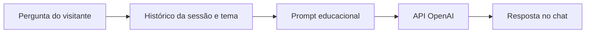

# Chatbot Financeiro — Educação em Investimentos

Protótipo de **assistente virtual educacional**, desenvolvido com Python, Streamlit e API OpenAI para esclarecer conceitos de investimentos no mercado brasileiro.

**[▶ Experimentar chatbot](https://chatbot-financeiro-9p1s.onrender.com/)** · **Python** · **Streamlit** · **OpenAI API** · **IA generativa**


**Estado:** aplicação publicada no Render, com acesso direto, sem senha para visitantes. A operação depende da chave da API configurada apenas no servidor; o funcionamento do chat foi confirmado durante os testes do projeto.

### Visão rápida

| Tema | Experiência | Tecnologia |
|---|---|---|
| Renda fixa e renda variável | Perguntas e respostas educativas com contexto por sessão | Streamlit + API OpenAI |



> **Atenção:** o sistema não possui cotações em tempo real e não presta recomendações personalizadas. Há limite básico de respostas por sessão, que não substitui controles de custo na API.

## Objetivo

Demonstrar integração de IA generativa em uma aplicação conversacional, com interface web, engenharia de prompts, delimitação temática e histórico de diálogo separado por sessão e por tema.

### O que o projeto faz

- Responde perguntas educativas sobre **renda fixa** e **renda variável**.
- Mantém contexto recente da conversa para cada tema **na sessão atual**.
- Permite limpar o histórico do tema, sem afetar outro tema.
- Restringe o uso a um domínio financeiro educacional por instruções de sistema.
- Não consulta cotações em tempo real nem oferece recomendações personalizadas.

## Diferença em relação ao BazinBot

| Chatbot Financeiro | [BazinBot](https://github.com/alvarobonifacio1980/BazinBot) |
|---|---|
| Conversação com IA generativa | Avaliação numérica de ações pelo Método de Bazin |
| Explicações conceituais | Coleta de dividendos e preços |
| Temas de renda fixa e variável | Estudo específico de valuation |
| Exige uma chave de API OpenAI | Depende de dados de mercado |

Os dois projetos são complementares, **não compartilham código nem processamento de dados**.

## Executar localmente

Requer Python 3.11+.

```bash
python -m pip install -r requirements.txt
export OPENAI_API_KEY="sua_chave"
streamlit run chat.py
```

No Windows PowerShell: `$env:OPENAI_API_KEY="sua_chave"`.

A chave também pode ser configurada nos *secrets* do Streamlit ou nas variáveis de ambiente da hospedagem. **Nunca inclua chaves no Git**. O arquivo `.env.example` é apenas ilustrativo; variáveis de um arquivo `.env` não são carregadas automaticamente.

## Preparação para publicação no Render

O repositório inclui `render.yaml` com as configurações do serviço web. Para configurar a implantação no [Render](https://dashboard.render.com/), conecte o repositório `alvarobonifacio1980/chatbot`, selecione a branch `main` e utilize:

```text
Build Command: pip install -r requirements.txt
Start Command: streamlit run chat.py --server.address 0.0.0.0 --server.port $PORT --server.headless true
```

Configure **OPENAI_API_KEY** como variável de ambiente secreta no painel do Render. O valor não deve aparecer em commits, prints públicos ou arquivos do projeto. O plano gratuito do Render não torna gratuitas as chamadas à API OpenAI: consulte cobrança e estabeleça limites de uso antes de disponibilizar o chatbot publicamente.

**Status:** serviço criado no Render: https://chatbot-financeiro-9p1s.onrender.com. Configure a variável `OPENAI_API_KEY` no painel [Environment do Render](https://dashboard.render.com/web/srv-dbgg1bff3r2c73eh4q3g/env). O acesso é público e existe um limite de dez perguntas por sessão, apenas como contenção básica; isso não impede sessões repetidas nem substitui limites de consumo na API. A integração com a API precisa ser validada com uma conversa real após essa configuração. Estabeleça limites de gasto na conta OpenAI antes da divulgação.

## Acesso público e controle de custos

O chat pode ser aberto **sem senha**. O código limita a **dez respostas geradas por sessão de navegador**, mas o limite pode ser reiniciado ao abrir outra sessão e não protege contra automação ou abuso deliberado. Uma pergunta que falha antes da resposta também pode consumir tokens na API. Configure controles de orçamento, alertas e cotas efetivas do lado do provedor/gateway antes de divulgação ampla.

A variável `CHATBOT_ACCESS_PASSWORD`, se estiver cadastrada no Render, **não é mais utilizada** e pode ser excluída do painel Environment. **Não exclua `OPENAI_API_KEY`**.

## Executar testes

```bash
python -m unittest discover -s tests -v
```

GitHub Actions executa verificação de sintaxe e testes offline em cada alteração. Esses testes não consomem créditos da API e **não equivalem a uma execução integrada com o serviço OpenAI**.

## Arquitetura

```text
chat.py               # Interface Streamlit e estado por sessão
chat_core.py          # Regras de entrada, histórico e prompt de sistema
modelo_openai.py      # Chamada isolada ao modelo
tests/                # Testes de lógica sem credenciais
.github/workflows/    # Verificação automática
requirements.txt      # Bibliotecas da aplicação
.env.example          # Modelo de configuração, sem segredos
```

## Privacidade e limites

As mensagens permanecem na memória da sessão Streamlit no servidor durante o uso e são enviadas à API OpenAI para gerar respostas. **Não há persistência em banco de dados nem exportação das conversas implementada no código**, mas a plataforma de hospedagem e a API podem processar informações conforme suas políticas. Não envie CPF, senhas, contas ou dados financeiros sensíveis.

O prompt delimita o tema, mas **não garante bloqueio absoluto** de perguntas fora do escopo. As respostas podem conter erros e não substituem orientação de profissionais habilitados.

Este projeto demonstra uma aplicação de IA conversacional; **não presta consultoria, análise certificada ou assessoria de investimentos**.

---

**Autor:** Álvaro Bonifácio.
